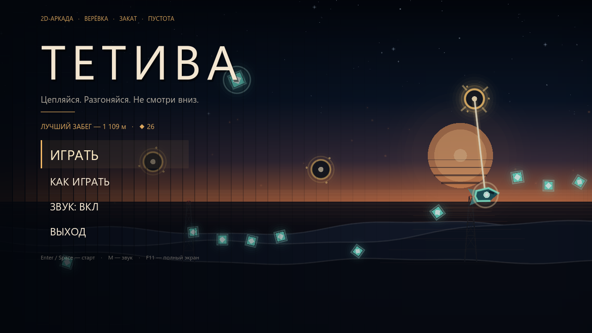
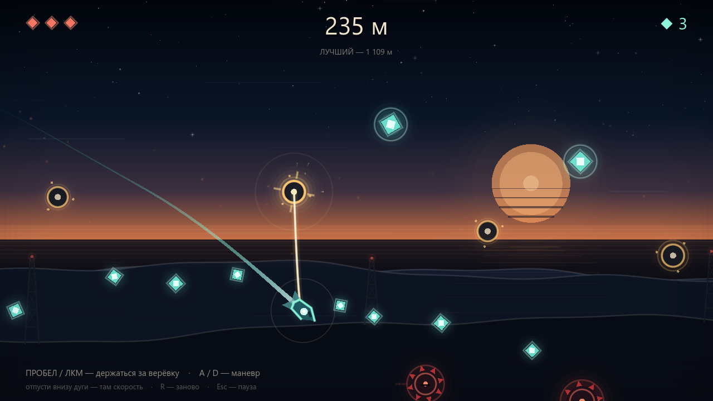
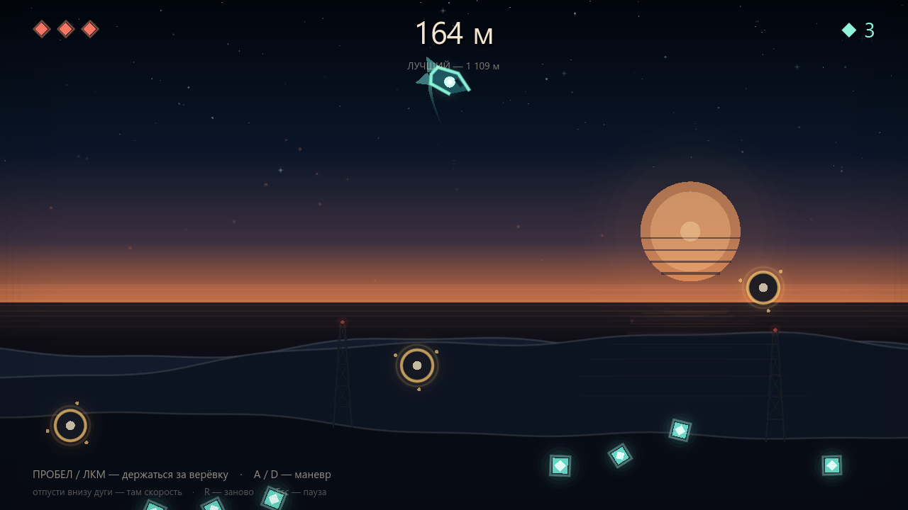
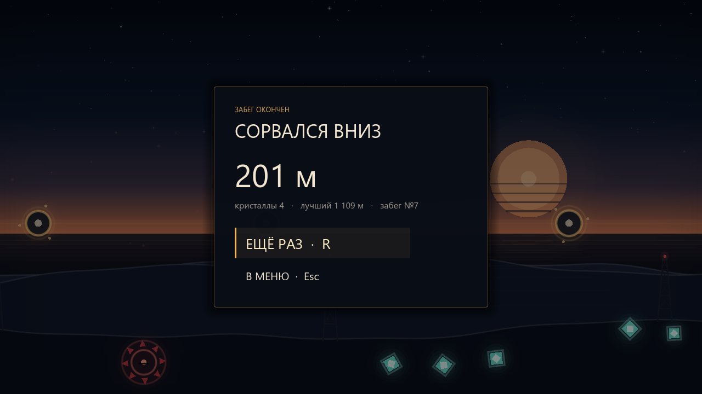

# ТЕТИВА

**2D-аркада на верёвке для ПК.** Ты — беглец между радиовышками на закатной пустоши:
цепляйся за якоря, раскачивайся маятником и улетай вперёд. Один забег длится до первого
падения в туман или до третьего попадания в мину.



## Играть

| Действие | Клавиатура / мышь | Геймпад |
|---|---|---|
| Держать верёвку / зацепиться за якорь | `Пробел` или ЛКМ | `A` / `RT` |
| Отпустить верёвку | отпустить кнопку | отпустить |
| Маневрировать в воздухе / раскачиваться | `A` `D` или `←` `→` | левый стик |
| Начать заново | `R` | `Y` |
| Пауза | `Esc` / `P` | `Start` |
| Звук вкл/выкл | `M` | — |
| Полный экран | `F11` | — |

## Правила

- **Забег начинается уже на верёвке.** Пока не нажмёшь и не отпустишь кнопку — висишь и раскачиваешься,
  упасть в первые секунды нельзя. Первый якорь — прямо над тобой.
- **Держи кнопку — цепляешься** за подсвеченный якорь в радиусе. Отпустил — полетел.
- После зацепа лебёдка **подтягивает верёвку**: длинный зацеп даёт широкую дугу, короткий — быстрый вираж.
- **Отпускай верёвку в нижней точке дуги** (или сразу после неё): там максимальная скорость.
  Если отпустить на подъёме, полёт будет выше, но медленнее.
- **Кристаллы** висят под цепочкой якорей: маленький даёт 1, большой — 5. Счёт забега — дистанция,
  кристаллы копятся отдельно.
- **Три сердца.** После удара — 1,6 с неуязвимости и мигание. Шипастые мины стоят в нижней части дуг,
  часть из них медленно дрейфует.
- **Ниже — туман.** Упал за нижнюю границу — забег окончен. Чем ниже спускаешься, тем краснее экран.
- Мир **процедурный**: с каждым забегом якоря, кристаллы и мины расставляются заново.
  Чем дальше, тем шире разрывы и больше мин.
- Рекорд по дистанции и лучший сбор кристаллов сохраняются между запусками.







## Запуск

**Быстрый способ — `play.bat`.** Он сам находит Godot из Steam (или в `PATH`) и запускает проект.
Если Godot лежит в другом месте, поправь переменную `GODOT` в начале файла.

**Через редактор:** открой `project.godot` в Godot 4.4+, нажми `F5`.

**Из консоли:**

```bat
"C:\Program Files (x86)\Steam\steamapps\common\Godot Engine\godot.windows.opt.tools.64.exe" --path .
```

Экспорт в `.exe` не приложен: готовых шаблонов экспорта на машине не было. Если нужен
самостоятельный бинарник, поставь *Editor → Manage Export Templates…* и сделай
*Project → Export → Windows Desktop*.

## Под капотом

- **Godot 4.4.1**, GDScript, рендер `GL Compatibility`, логическое разрешение 1280×720
  с растяжением `canvas_items` — окно можно ресайзить и разворачивать.
- **Вся графика рисуется кодом**: `_draw()` для якорей, кристаллов, мин, корабля, неба и эффектов,
  `Line2D` — для следа. Внешних текстур и спрайтов нет.
- **Физика верёвки — собственный маятник**, а не PinJoint: натянутая верёвка ограничивает расстояние
  и гасит радиальную скорость, провисшая — даёт свободное падение; лебёдка подтягивает трос,
  ввод добавляет касательное ускорение.
- **Процедурная цепочка** якорей строится с ограничением длины и перепада высот, чтобы мир оставался
  проходимым; опасности появляются примерно после 180 м, кристаллы расставляются вдоль дуг. Старые объекты
  обрезаются, поэтому забег может длиться сколько угодно.
- **Звук синтезирован** скриптом `tools/make_audio.py` на numpy: музыкальный луп 92 BPM (ля минор),
  эффекты зацепа/рывка/кристалла/урона/смерти и зацикленный ветер, громкость которого зависит от скорости.
  `assets/audio/*.wav` — уже готовые файлы; пересобрать: `python tools/make_audio.py`.
- **Рекорды** хранятся в `ConfigFile` по пути `user://settings.cfg`
  (на Windows — `%APPDATA%\Godot\app_userdata\ТЕТИВА\settings.cfg`).

### Файлы

```text
project.godot            настройки, автозагрузки, главная сцена
scenes/main.tscn         точка входа (собирает UI из кода)
scenes/game.tscn         сцена забега: небо, уровень, игрок, камера, эффекты
scripts/boot.gd          input map + настройки/рекорды
scripts/main.gd          меню, HUD, пауза, game over, отладочные режимы
scripts/game.gd          логика забега, сердца, камера, attract-режим
scripts/player.gd        маятник, зацеп, ввод, отрисовка корабля
scripts/level.gd         генерация мира, отрисовка якорей/кристаллов/мин
scripts/sky.gd           параллакс-фон, солнце, вышки, туман
scripts/sparks.gd        частицы и ударные кольца
scripts/fx.gd            экранные эффекты: спидлайны, виньетка, вспышки
scripts/gfx.gd           общие примитивы отрисовки
scripts/sfx.gd           пул звуков, музыка, ветер, mute
scripts/lives_bar.gd     сердца в HUD
tools/make_audio.py      генератор WAV (numpy)
assets/audio/            музыка, SFX, ветер
docs/screenshots/        скриншоты для README
```

## Отладочные режимы

Для проверки без ручного прохождения в игру встроены два флага (аргументы после `--`):

```bat
:: снимок экрана в captures/<имя>.png: menu | play | swing | over | pause | help
godot --path . -- --capture=play

:: автотест: автопилот играет N секунд ускоренно, печатает дистанцию и причину смерти
godot --path . -- --simulate=20

:: то же, но с неуязвимостью — проверка генерации на длинной дистанции
godot --path . -- --simulate=12 --god
```

Автопилот используется только в attract-режиме меню, для скриншотов и симуляций; в обычном
забеге он выключен. Снимки пишутся в `captures/` и не сохраняют рекорды.

## Требования

- Windows 10/11, Godot 4.4+ (тестировалось на 4.4.1 и GL Compatibility / NVIDIA GTX 1650).
- Клавиатура и мышь; геймпад поддерживается, но переназначение кнопок пока только в коде
  (`scripts/boot.gd`).
- Системный шрифт Segoe UI (есть в Windows) — поэтому русский текст рисуется без внешних шрифтов.
